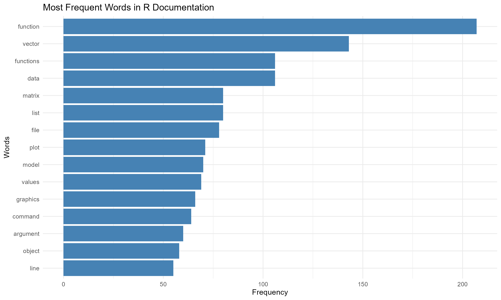
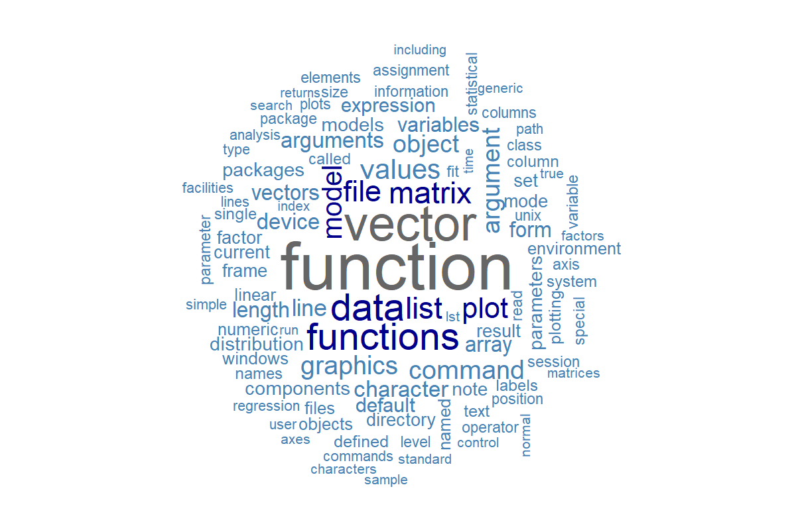
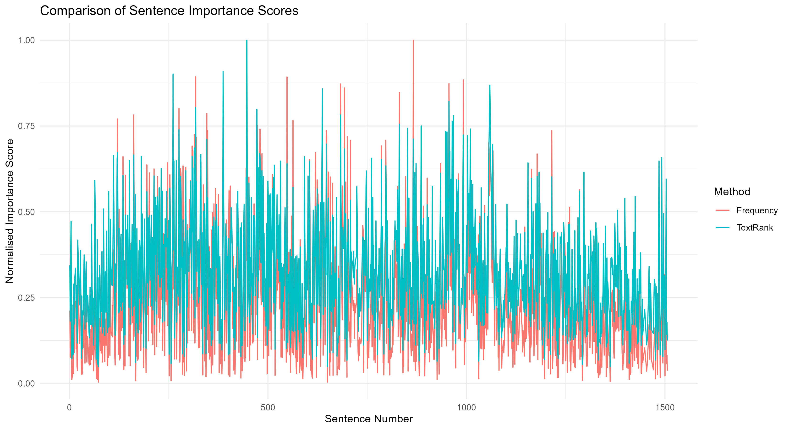
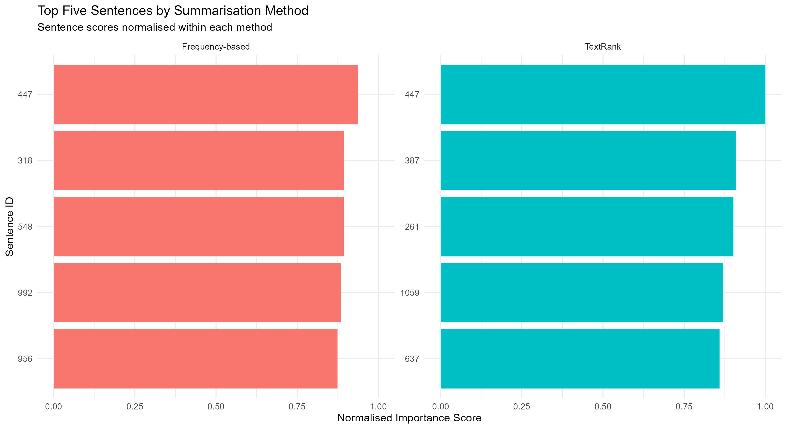

# Advancing Research Analysis Using Web Scraping and Text Summarisation

## 1. Introduction

This analysis demonstrates the application of web scraping, textual data preprocessing and automated text summarisation using R.

The objective is to extract unstructured textual information from a publicly accessible educational website, organise the extracted content into an R data structure, preprocess the text for analysis and apply two extractive summarisation techniques.

The analysis uses frequency-based summarisation and TextRank to identify important sentences within the collected information. The results are examined using visualisations to compare the importance assigned to sentences by each technique.

## 2. Website Selection and Web Scraping (Question 3.1)

### 2.1 Website Selection

The selected website is the official Comprehensive R Archive Network (CRAN) documentation, specifically the manual *An Introduction to R*.

**Website:** https://cran.r-project.org/doc/manuals/r-release/R-intro.html

The website was selected because it provides structured educational content covering R programming, statistical computing, data structures, functions, statistical modelling and graphics.

### 2.2 Web Scraping Implementation

Web scraping was performed using R, with the `rvest` package used to retrieve and parse HTML content.

The extraction process involved reading the website's HTML document, identifying paragraph elements, extracting their textual content and organising the results into a structured data frame.

The extracted records were associated with the source URL, document title and paragraph identifiers.

**R script:** `WebText_API/scripts/scrapping.r`

**Raw dataset:** `WebText_API/data/raw/web_content.csv`

### 2.3 Extracted Data Structure

The initial extraction produced **814 paragraph records**.

The extracted information was organised into an R data frame containing four variables:

| Variable | Description |
|---|---|
| `url` | Source website address |
| `title` | Title of the source document |
| `paragraph_id` | Identifier assigned to each paragraph |
| `content` | Extracted paragraph text |

After removing irrelevant and duplicate content, the resulting dataset contained **696 paragraph records and four variables**.

**Processed dataset:** `WebText_API/data/processed/web_content_clean.csv`

### 2.4 Findings

The extraction successfully transformed HTML-based web content into a structured R dataset.

The reduction from 814 to 696 paragraph records indicates that 118 records were excluded during cleaning, representing approximately 14.5% of the initially extracted records.

The resulting dataset retained textual content relating to R programming, statistical computing, functions, data structures and graphical analysis.

## 3. Textual Data Preprocessing (Question 3.2)

### 3.1 Preprocessing Objective

The purpose of textual preprocessing was to remove non-pertinent information and standardise the extracted content before performing text analysis and summarisation.

Web-based textual data may contain navigation information, duplicate content, formatting inconsistencies, punctuation, numbers and commonly occurring words that contribute limited analytical value.

Preprocessing reduces the influence of such information and prepares the text for word-frequency analysis and sentence scoring.

### 3.2 Preprocessing Techniques

Text preprocessing was performed using R packages including `dplyr`, `stringr` and `tidytext`.

The implemented techniques included:

1. **Removal of irrelevant content:** Excluded navigation-related and other non-analytical content from the extracted paragraphs.
2. **Duplicate removal:** Removed repeated textual records to reduce unnecessary repetition.
3. **Text standardisation:** Prepared text for consistent processing and comparison.
4. **Tokenisation:** Separated textual content into individual word tokens.
5. **Stopword removal:** Excluded frequently occurring English words such as "the", "and" and "is", which generally contribute limited thematic information.
6. **Token filtering:** Removed numeric and non-alphabetic tokens from the word-level analytical dataset.
7. **Word-frequency calculation:** Counted occurrences of retained words to identify recurring terminology.

The original paragraph content was retained in the processed dataset for sentence-level summarisation, while token-level filtering supported word-frequency analysis.

**R script:** `WebText_API/scripts/textual_processing.r`

### 3.3 Preprocessing Results

The word-level preprocessing produced the following results:

| Measure | Result |
|---|---:|
| Cleaned paragraph records | 696 |
| Initial word tokens | 26,848 |
| Retained word tokens | 10,394 |
| Removed word tokens | 16,454 |
| Percentage of tokens retained | 38.7% |
| Percentage of tokens removed | 61.3% |

The reduction in tokens reflects the removal of common and non-pertinent terms from the analytical vocabulary.

This does not mean that 61.3% of the original document's meaningful information was removed, as token filtering is different from deleting complete paragraphs.

### 3.4 Word-Frequency Analysis

The most frequently occurring words included:

| Word | Frequency |
|---|---:|
| function | 207 |
| vector | 143 |
| data | 106 |
| functions | 106 |
| list | 80 |
| matrix | 80 |
| file | 78 |
| plot | 71 |
| model | 70 |
| values | 69 |

The prominence of words such as `function`, `vector`, `matrix` and `data` is consistent with the technical nature of the selected documentation.

The presence of terms such as `plot`, `model` and `values` also reflects the manual's emphasis on statistical computing and graphical analysis.

### 3.5 Preprocessing Visualisations

#### 3.5.1 Word-Frequency Bar Chart

The horizontal bar chart displays the fifteen most frequently occurring retained words.

The horizontal axis represents word frequency, while the vertical axis identifies the corresponding terms.

The results show that `function` occurs most frequently, followed by `vector`, `data` and `functions`.

These findings suggest that programming functions and data structures are prominent subjects within the collected documentation.

#### 3.5.2 Word Cloud

The word cloud provides a visual representation of recurring terminology within the processed text.

Words appearing more frequently are displayed more prominently, making it easier to identify dominant concepts.

The visualisation reinforces the word-frequency findings by highlighting technical vocabulary associated with R programming, data structures and statistical analysis.

### 3.6 Preprocessing Interpretation

The preprocessing stage successfully converted the collected paragraphs into a word-level analytical dataset.

Stopword removal and token filtering reduced the influence of common and non-alphabetic tokens, allowing domain-specific terminology to become more prominent.

The resulting word-frequency distribution indicates that the selected manual focuses substantially on functions, vectors, matrices and other programming concepts.

However, filtering non-alphabetic tokens may also exclude meaningful programming expressions, operators and numeric examples.

## 4. Text Summarisation (Question 3.3)

### 4.1 Summarisation Objective

The objective of text summarisation was to identify important sentences from the collected web content without manually reviewing every paragraph.

Two extractive summarisation techniques were implemented:

1. Frequency-based extractive summarisation.
2. Graph-based TextRank summarisation.

Both techniques select existing sentences from the source material rather than generate new sentences.

The extracted paragraphs were divided into sentences using `tidytext`, and sentences containing more than 30 characters were retained.

This produced **1,386 sentences** for sentence-level analysis.

**R script:** `WebText_API/scripts/text_summarisation.r`

### 4.2 Frequency-Based Summarisation

Frequency-based summarisation assigns importance to sentences according to the occurrence of frequently used words.

The implementation first tokenised sentences, removed stopwords and excluded non-alphabetic terms.

Word frequencies were then calculated across the sentence collection.

Each sentence received a score based on the sum of its constituent word frequencies, adjusted by the square root of the number of retained words.

The scoring approach can be expressed as:

**Sentence score = Sum of word-frequency values / √(Number of retained words)**

This adjustment reduces the tendency for longer sentences to receive higher scores simply because they contain more words.

Sentences containing between 8 and 60 retained words were considered for selection, and the five highest-scoring sentences were extracted.

#### Frequency-Based Findings

The selected sentences discussed several aspects of R programming, including:

- Array indexing and dimension handling.
- Lists containing different types of data.
- Statistical probability functions.
- Plotting numeric vectors.
- Low-level graphical functions.

The results demonstrate that word-frequency scoring can identify sentences containing recurring technical terminology.

However, the extracted sentences represent different sections of the manual and do not necessarily form a continuous explanation of the document.

### 4.3 TextRank Summarisation

TextRank is a graph-based extractive summarisation technique that identifies important sentences using relationships between sentences.

Unlike frequency-based summarisation, which relies on word occurrence counts, TextRank evaluates the importance of sentences according to their similarity and connections within the document.

The implementation followed these stages:

1. Tokenised the extracted sentences and removed stopwords.
2. Constructed a sentence-term matrix.
3. Calculated Term Frequency-Inverse Document Frequency (TF-IDF) weights.
4. Calculated cosine similarity between sentence representations.
5. Constructed a weighted sentence similarity graph.
6. Applied the PageRank algorithm to calculate sentence importance scores.
7. Selected the five highest-ranked sentences.

The sentence-term matrix contained **1,385 sentences and 2,392 unique terms**.

One sentence was excluded from this representation because it did not retain eligible word tokens after filtering.

Sparse-matrix operations were used through the `Matrix` package to support memory-efficient calculations.

The `igraph` package was used for graph construction and PageRank scoring.

#### TextRank Findings

TextRank identified sentences discussing:

- R object types, including vectors, matrices, arrays, factors and data frames.
- Function outputs containing values and vectors.
- Lists containing different data types.
- Function usage and programming syntax.
- Graphics parameters.

The highest-ranked sentence was **sentence 447**, with a PageRank score of approximately **0.002220**.

This sentence describes the ability of R lists to contain different types of objects, including vectors, matrices, character arrays and functions.

The result suggests that the sentence has a comparatively strong position within the constructed similarity graph.

However, TextRank also selected a sentence containing incomplete programming syntax, demonstrating that statistical importance does not necessarily guarantee readability.

## 5. Summarisation Visualisations and Interpretation

### 5.1 Comparison of Sentence Importance Scores

**Figure 1: Comparison of Sentence Importance Scores**

The line chart compares the normalised sentence importance scores generated by frequency-based summarisation and TextRank.

The horizontal axis represents sentence identifiers, while the vertical axis represents normalised importance scores.

The two methods are distinguished using the chart legend.

Scores were normalised relative to the maximum score produced by each method, allowing their relative scoring patterns to be displayed on a common scale.

The results show that the frequency-based method produces pronounced peaks for selected sentences, whereas TextRank produces a different distribution of sentence importance.

These differences reflect the scoring approaches used by the two methods.

Frequency-based summarisation prioritises sentences containing frequently occurring words, while TextRank considers similarity relationships between sentences.

The normalised scores should not be interpreted as directly equivalent absolute measures of importance across the two algorithms.

### 5.2 Top Five Sentences by Summarisation Method

**Figure 2: Top Five Sentences by Summarisation Method**

The horizontal bar chart presents the five highest-ranked sentences selected by each summarisation technique.

The horizontal axis represents normalised sentence importance scores, while the vertical axis identifies the sentence IDs.

The chart uses separate panels to distinguish the frequency-based and TextRank results.

Sentence **447** was selected by both methods and received the highest importance score within each method's selected results.

The remaining selected sentences differed between the methods.

This indicates that the techniques identify important information using different criteria, even when applied to the same source material.

The agreement on sentence 447 suggests that the sentence is prominent both in terms of recurring terminology and its similarity relationships with other sentences.

### 5.3 Comparison of Summarisation Techniques

| Aspect | Frequency-Based Summarisation | TextRank |
|---|---|---|
| Technique | Word-frequency scoring | Graph-based sentence ranking |
| Main input | Word occurrence frequencies | TF-IDF sentence representations |
| Sentence importance | Sum of word frequencies adjusted for length | PageRank scores from sentence similarities |
| Sentences selected | Five | Five |
| Main advantage | Straightforward and interpretable | Considers relationships between sentences |
| Main limitation | May favour frequently repeated terminology | May select incomplete or context-dependent sentences |

Both methods successfully identified sentences containing terminology relevant to the selected manual.

However, the extracted summaries were not identical. The differences demonstrate that sentence importance depends on the criteria used by the summarisation algorithm.

## 6. Conclusion

The analysis demonstrated how R can be used to extract, preprocess, analyse and summarise textual information from a publicly accessible website.

Web scraping produced an initial dataset of 814 paragraph records, which was reduced to 696 records after cleaning.

Textual preprocessing reduced 26,848 initial word tokens to 10,394 retained tokens, revealing frequently occurring terminology associated with R programming and statistical computing.

Two extractive summarisation techniques were implemented successfully. Frequency-based summarisation identified sentences containing recurring terminology, while TextRank ranked sentences according to their similarity relationships.

The visualisations demonstrated differences in sentence importance scores and highlighted the overlap between the sentences selected by both techniques.

Although the methods produced technically valid summaries, some selected sentences were incomplete or lacked sufficient context. This demonstrates the importance of evaluating summary quality in addition to algorithmic execution.

Overall, the analysis illustrates how web scraping, natural language processing and graph-based methods can support automated exploration of large textual documents.

## 7. R Scripts and Output Files

### 7.1 R Scripts

The complete R implementation is available in the `WebText_API/scripts/` directory.

| Script | Purpose |
|---|---|
| `scrapping.r` | Website extraction and initial text cleaning |
| `textual_processing.r` | Text preprocessing, word-frequency analysis and visualisation |
| `text_summarisation.r` | Frequency-based summarisation, TextRank and summary comparison visualisations |

The scripts provide the implementation supporting the methodology and findings described in this document.

### 7.2 Data Outputs

**Raw data directory:** `WebText_API/data/raw/`

- `web_content.csv`

**Processed data directory:** `WebText_API/data/processed/`

- `web_content_clean.csv`

### 7.3 Visualisation Outputs

**Directory:** `WebText_API/figures/`

- `word_frequency.png`
- `word_cloud.png`
- `summary_comparison.png`
- `top_summary_sentences.png`

## 8. Source

R Core Team. *An Introduction to R*. Comprehensive R Archive Network (CRAN).

https://cran.r-project.org/doc/manuals/r-release/R-intro.html

The original source is acknowledged for its educational and technical content.
