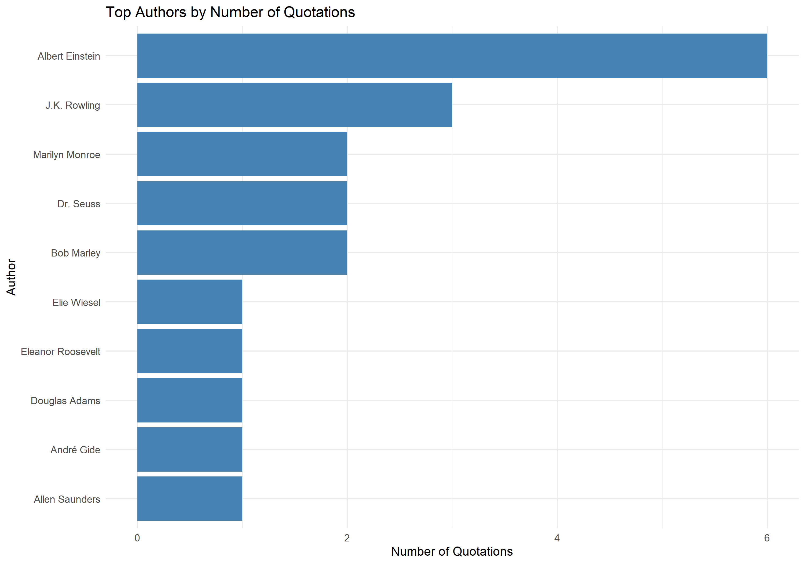

# Web Scraping, ETL and PostgreSQL Analysis

## 1. Introduction

This project demonstrates an Extract, Transform and Load (ETL) workflow using R and PostgreSQL. Quotation data was extracted from [Quotes to Scrape](https://quotes.toscrape.com/), cleaned and transformed in R, loaded into a relational database, and analysed using SQL.

The objective was to demonstrate web scraping, data quality assessment, database integration, SQL aggregation and data visualisation.

## 2. Data Extraction (Question 4.1)

The extraction process was implemented in R using the `rvest`, `dplyr`, `stringr`, `purrr` and `tibble` packages.

The first three pages of the website were scraped, producing **30 quotations** with five variables:

| Variable | Description |
|---|---|
| `quote` | Quotation text |
| `author` | Author of the quotation |
| `tags` | Associated quotation categories |
| `source_page` | Website page from which the quotation was extracted |
| `quote_length` | Number of words in the quotation |

The extracted dataset was saved as `ETL_PostgreSQL/data/raw_quotes.csv`.

## 3. Data Cleaning and Transformation (Question 4.2)

Data cleaning was performed in R using `dplyr`, `stringr` and `tidyr`.

The transformation process included:

- Standardising whitespace and removing surrounding quotation marks.
- Checking for missing and empty values.
- Replacing missing author values with `Unknown`.
- Replacing missing tags with `Uncategorised`.
- Removing duplicate quotation-author combinations.
- Recalculating quotation lengths as word counts.

### Data quality results

| Quality measure | Before | After |
|---|---:|---:|
| Records | 30 | 30 |
| Missing or blank authors | 0 | 0 |
| Missing or blank tags | 1 | 0 |
| Duplicate quotation-author pairs | 0 | 0 |

The cleaning process retained all 30 records.

The cleaned dataset was saved as `ETL_PostgreSQL/data/clean_quotes.csv`, and the data quality report was saved as `ETL_PostgreSQL/results/data_quality_report.csv`.

## 4. PostgreSQL Database Integration (Question 4.3)

A dedicated PostgreSQL database named `quotes_etl_db` was created to store the cleaned quotation records.

A relational table named `quotes` was created using the SQL `CREATE TABLE IF NOT EXISTS` statement. The table contains six columns, including an automatically generated primary key.

| Column | Data type | Purpose |
|---|---|---|
| `quote_id` | SERIAL PRIMARY KEY | Automatically generated unique identifier |
| `quote` | TEXT | Quotation content |
| `author` | VARCHAR(255) | Author name |
| `tags` | TEXT | Comma-separated categories |
| `source_page` | INTEGER | Original webpage number |
| `quote_length` | INTEGER | Quotation word count |

The cleaned dataset, `clean_quotes.csv`, was imported into PostgreSQL using the `\copy` command. The import successfully transferred all 30 records into the `quotes` table.

R database connectivity was subsequently implemented using the `DBI` and `RPostgres` packages. The R script established a connection to PostgreSQL, retrieved the imported record count, executed the two analytical SQL queries and exported their results to CSV files.

A verification query confirmed that all 30 quotation records were successfully stored in the database.

The database connection and analytical operations were successfully executed through the R script `ETL_PostgreSQL/scripts/PostgreSQL.r`.

## 5. SQL Investigation 1: Author Analysis

The first SQL investigation used `COUNT()`, `AVG()`, `GROUP BY` and `ORDER BY` to determine the most frequently represented authors and their average quotation lengths.

### Findings

| Author | Quotations | Average words |
|---|---:|---:|
| Albert Einstein | 6 | 19.00 |
| J.K. Rowling | 3 | 23.67 |
| Bob Marley | 2 | 75.50 |
| Dr. Seuss | 2 | 17.50 |
| Marilyn Monroe | 2 | 108.50 |

Albert Einstein was the most frequently represented author, contributing 20% of the dataset. Marilyn Monroe had the highest average quotation length among the ten authors returned by the query.

The results were saved in `ETL_PostgreSQL/results/author_analysis.csv`.

## 6. SQL Investigation 2: Tag Analysis

The second SQL investigation analysed quotation categories by splitting comma-separated tags into individual values using PostgreSQL's `string_to_array()` and `unnest()` functions.

### Findings

| Category | Occurrences | Average words |
|---|---:|---:|
| life | 7 | 44.57 |
| love | 6 | 79.50 |
| inspirational | 5 | 58.40 |
| humor | 4 | 19.75 |
| friends | 3 | 79.00 |
| books | 2 | 16.00 |
| friendship | 2 | 14.50 |

Life was the most frequently occurring category, followed by love and inspirational quotations.

Quotations associated with love and friends had relatively high average word counts, whereas humorous quotations were generally shorter within the analysed sample.

Because individual quotations may contain multiple tags, category occurrence counts are not mutually exclusive.

The results were saved in `ETL_PostgreSQL/results/tag_analysis.csv`.

## 7. Data Visualisation

The author analysis was visualised using R's `ggplot2` package.

A horizontal bar chart was generated to compare the number of quotations attributed to each of the ten most frequently represented authors.

The visualisation supports the SQL findings by highlighting Albert Einstein as the most frequently represented author.

## 8. Limitations

The analysis was based on 30 quotations extracted from the first three pages of the website. Consequently, the findings describe the collected sample rather than the entire website.

Additionally, the dataset contains multiple tags per quotation, meaning category counts can overlap.

## 9. Conclusion

The project successfully demonstrated an end-to-end ETL workflow involving web scraping, data cleaning, relational database storage, SQL investigations and visualisation.

The workflow produced a cleaned dataset of 30 quotations, successfully loaded the records into PostgreSQL, and identified differences in author frequency, quotation length and category distribution.

The results demonstrate how R and PostgreSQL can be integrated to extract, prepare, store and analyse structured information from web-based sources.
