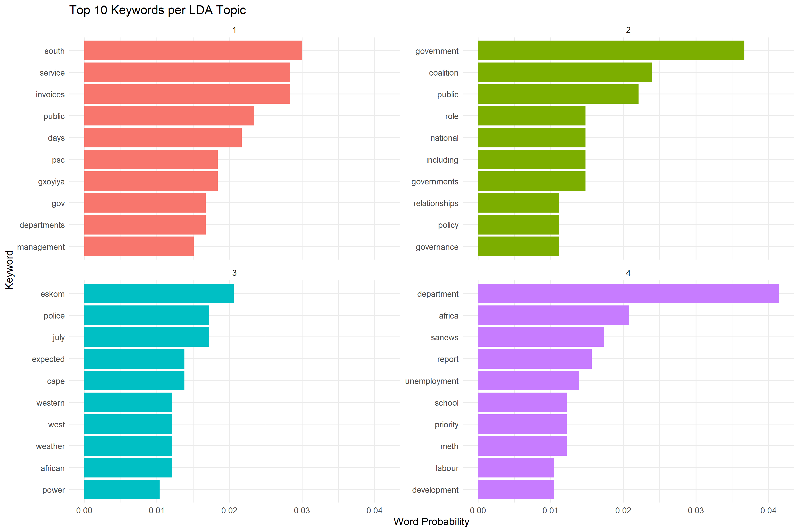
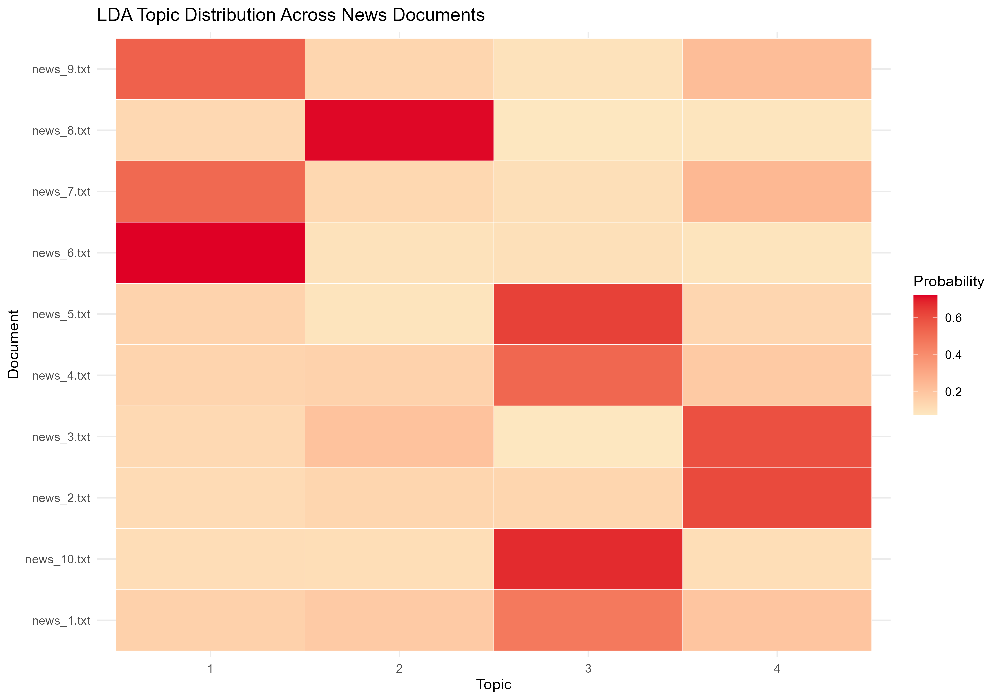

# Latent Dirichlet Allocation (LDA) Topic Modelling

## 1. Introduction

This analysis applies Latent Dirichlet Allocation (LDA) which is an unsupervised topic modelling technique used to identify underlying themes in a collection of ten South African news articles.

The objective is to preprocess unstructured textual data, discover recurring topics, and visualise the relationships between the identified topics and individual news documents.

## 2. Dataset Description

The dataset consists of ten text files,`news_1.txt` to `news_10.txt`, containing South African news articles.

**Data directory:** `LDA/data/raw/news/sa_news/`

Each article is treated as an individual document for topic modelling.

## 3. Data Preprocessing

Data preprocessing was performed in R using the `dplyr`, `stringr`, `tm`, and `tidytext` packages.

The following operations were performed:

1. Imported the ten text documents.
2. Converted the text to lowercase.
3. Removed URLs, punctuation, numbers, and unnecessary whitespace.
4. Tokenised the cleaned text into individual words.
5. Removed common English stop words.
6. Excluded words containing fewer than three characters.
7. Calculated word frequencies.
8. Constructed a Document-Term Matrix (DTM) representing word frequencies across documents.

The resulting data was exported to CSV files.

## 4. LDA Model Development

An LDA model was fitted using the `topicmodels` package in R.

**Model configuration:**

- Number of topics: 4
- Estimation method: Gibbs sampling
- Random seed: 123
- Burn-in iterations: 500
- Sampling iterations: 2,000
- Thinning interval: 100

The random seed was specified to support reproducibility.

The model produced two principal probability distributions:

- **Beta (β):** The probability of a word occurring within a particular topic.
- **Gamma (γ):** The probability of a topic occurring within a particular document.

The ten highest probability words were extracted for each topic, and the dominant topic was identified for each document.

## 5. Topic Identification and Interpretation

Four topics were identified from the news corpus.

### Topic 1: Public Service Administration and Payments

Prominent keywords include `south`, `service`, `invoices`, `public`, `days`, `psc`, `departments`, and `management`.

The topic appears to relate primarily to public service administration, departmental operations, and invoice payment processes.

### Topic 2: Government Coalitions and Governance

Prominent keywords include `government`, `coalition`, `public`,`national`, `governments`, `governance`, `policy`, and `relationships`.

These terms suggest a focus on government coalitions, governance arrangements, public policy, and relationships between government structures.

### Topic 3: Electricity, Weather and Public Safety

Prominent keywords include `eskom`, `police`, `july`, `cape`, `weather`, `western`, and `power`.

This topic combines terms associated with electricity supply, weather conditions, and policing. Its mixed vocabulary suggests that the model has grouped several potentially distinct news themes.

### Topic 4: Social Development and Employment

Prominent keywords include `department`, `africa`, `report`, `unemployment`, `school`, `priority`, `development`, and `labour`.

The topic appears to reflect government reporting and socioeconomic issues, particularly employment, education, and development.

## 6. Visualisation and Analysis

### 6.1 Top 10 Keywords per LDA Topic

The horizontal bar chart displays the ten highest-probability keywords for each of the four identified topics.

The horizontal axis represents topic-word probability (beta), while the vertical axis identifies the corresponding keywords.

The chart illustrates differences in vocabulary across the four topics. For example, `south` has the highest probability within Topic 1, while `eskom` has the highest probability within Topic 3.

### 6.2 Document-Topic Distribution Heatmap

The heatmap represents the distribution of four topics across the ten news documents.

Darker cells indicate higher document-topic probabilities (gamma), showing stronger associations between individual documents and particular topics.

Selected dominant-topic results include:

| Document | Dominant Topic | Probability |
|---|---|---|
| news_6.txt | Topic 1 | 72.0% |
| news_8.txt | Topic 2 | 71.6% |
| news_10.txt | Topic 3 | 67.7% |
| news_2.txt | Topic 4 | 60.8% |

The heatmap demonstrates that documents differ in their topic distributions, with some documents displaying stronger associations with a single topic than others.

## 7. Conclusion

The LDA analysis successfully identified four statistical topics from ten South African news articles.

Text preprocessing and Document-Term Matrix construction enabled the application of Gibbs-sampling-based LDA. The resulting topic-word and document-topic distributions were examined using a keyword probability chart and a document-topic heatmap.

The findings demonstrate how topic modelling can assist in exploring themes within unstructured textual data. However, the small corpus and overlapping vocabulary mean that the identified topics should be interpreted cautiously.

## 8. Output Files

**Data outputs:** `LDA/results/`

- `news_dataframe.csv`
- `cleaned_dataframe.csv`
- `word_frequencies.csv`
- `top_topic_words.csv`
- `document_topic_distribution.csv`

**Visualisation outputs:** `LDA/figures/`

- `topic_keywords.png`
- `document_topic_heatmap.png`
